# Mudeligen2 – treeningupildid (28.10.2026)

Need on **sinu arvuti Blenderi tegelikud renderdused**, mitte kunstlikult loodud illustratsioonid.

Treening: 28. oktoober 2026, alates 10:13. Esimene ülevaade kell 10:33. Selle hetke seis: **12 osakatset, 0 heakskiidetud osa**. All on ka ebaõnnestumiste pildid. Üksikud pildid on järjestatud katse numbri järgi.

## Nelja katse võrdlus

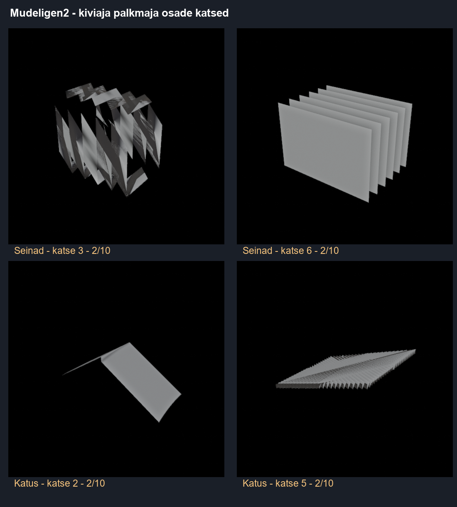

## Kõik 12 esimest katset

| Katse | Osa | Tulemus |
|:--|:--|:--|
| 1 | Seinad | Blenderi/koodi viga |
| 2 | Seinad | Loodud, kuid pole heaks kiidetud |
| 3 | Seinad | 2/10 |
| 4 | Seinad | Blenderi/koodi viga |
| 5 | Seinad | Blenderi/koodi viga |
| 6 | Seinad | 2/10 |
| 7 | Katus | Blenderi/koodi viga |
| 8 | Katus | 2/10 |
| 9 | Katus | Loodud, kuid pole heaks kiidetud |
| 10 | Katus | Loodud, kuid pole heaks kiidetud |
| 11 | Katus | 2/10 |
| 12 | Katus | Loodud, kuid pole heaks kiidetud |

### Katse 1

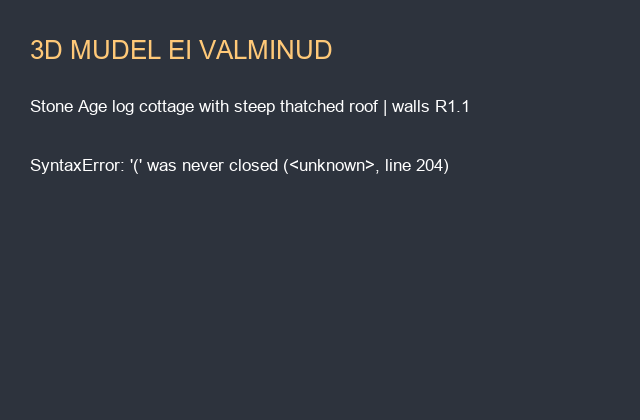

### Katse 2

### Katse 3

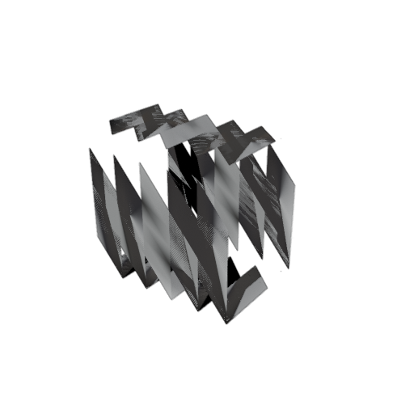

### Katse 4

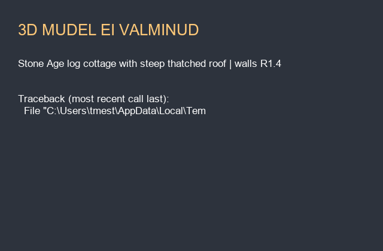

### Katse 5

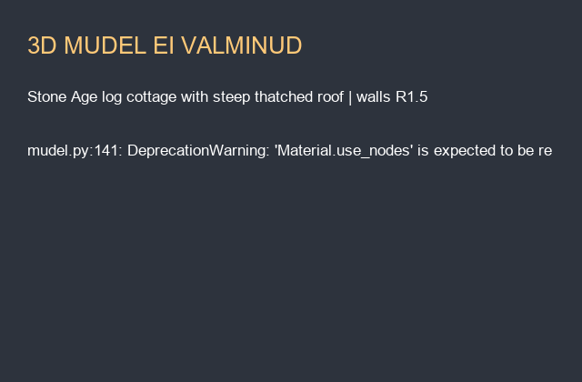

### Katse 6

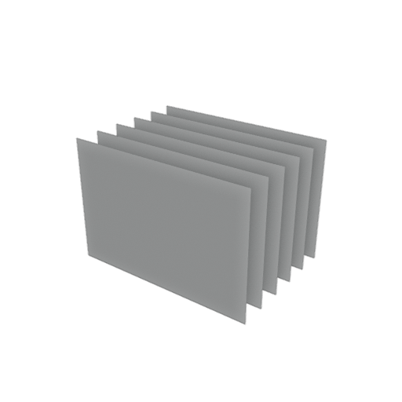

### Katse 7

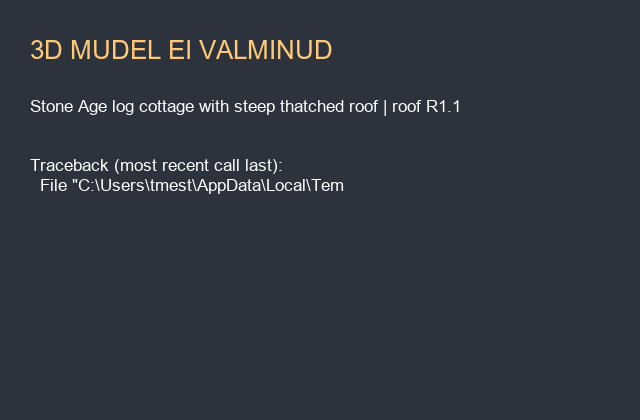

### Katse 8

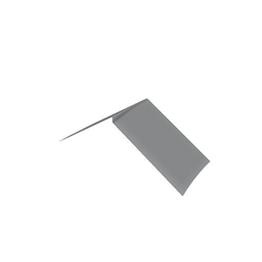

### Katse 9

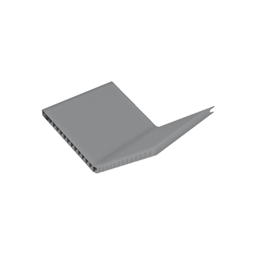

### Katse 10

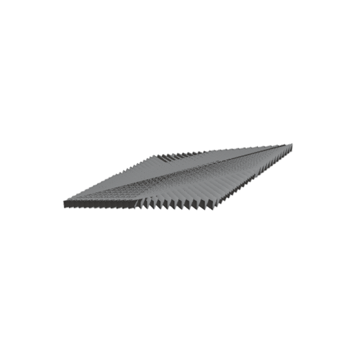

### Katse 11

### Katse 12

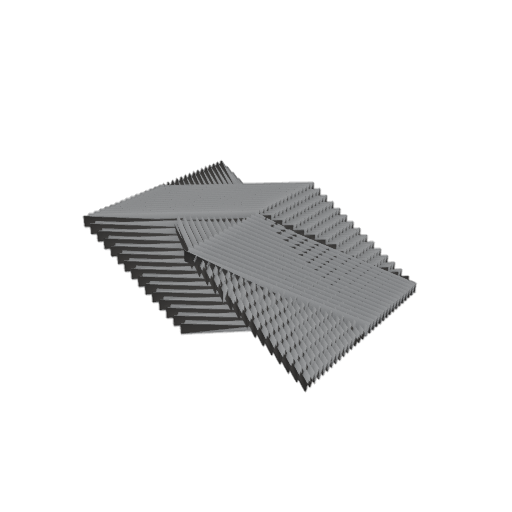

Pildid pärinevad Mudeligen2 treeningust Windowsi arvutis. Siin kajastub fikseeritud ülevaade, mitte automaatselt uuenev live-kaamera. Edasised treeningupildid tuleb eraldi üles laadida.
