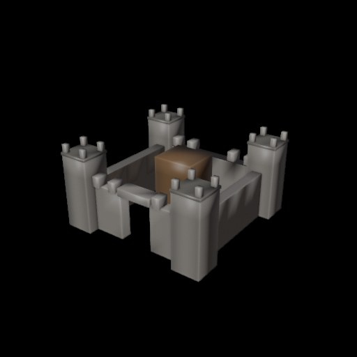
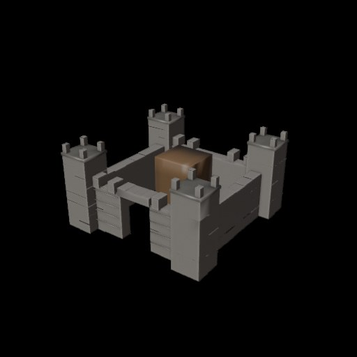
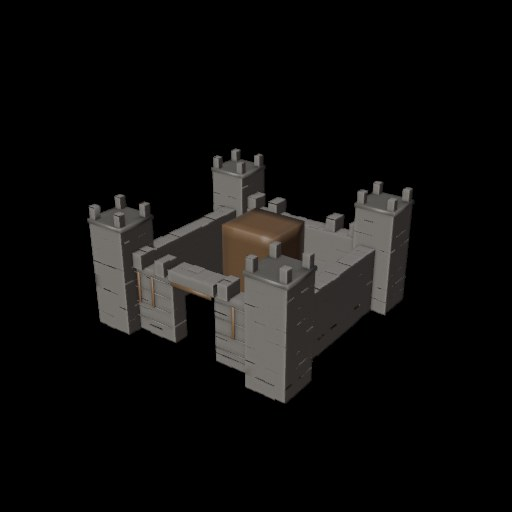
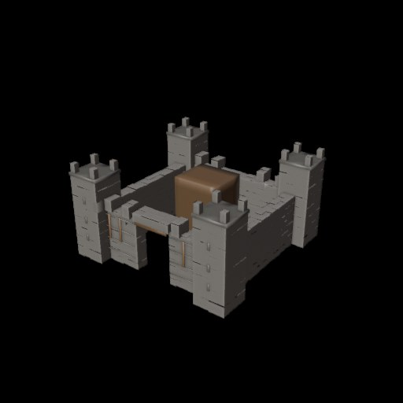
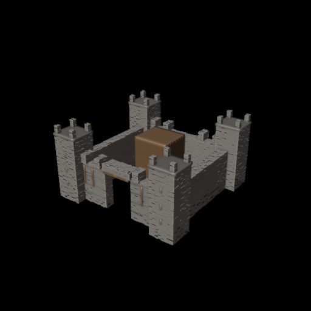
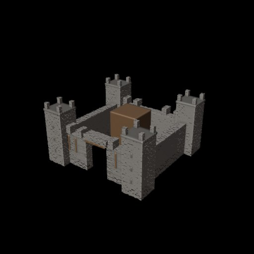
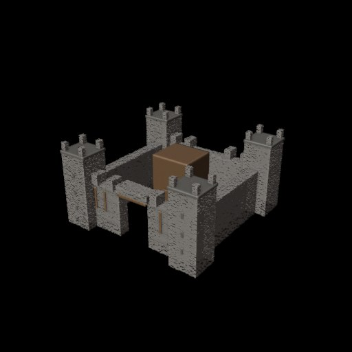

# Keskaegne kindlus – astmeline genereerimine

**28.10.2026 kell 15:10–15:15.** Kohaliku LM Studio Qwen 3.5 ja Blender 5.2 abil saavutati 11 astet. 50 quadist kasvatati võrk 51 200 quadini. Iga astme mudel salvestati ka Windowsis GLB-, BLEND-, PY- ja kahes PNG-vaates.

**Tulemus:** algne nurgatornide, müüriringi, väravaava ja sisehoovi peahoone paigutus jäi samaks. Qwen andis piltidele igal astmel hinde 6/10. Detaililisus ja geomeetria tihenesid, kuid 2× rohkem quade ei tähenda automaatselt 2× paremat kunstilist kvaliteeti.

**Kahe tunni piirang oli maksimum, mitte kohustuslik tööaeg:** määratud 11 detailiastet said täis 269 sekundiga (~4,5 minutit), mistõttu protsess lõpetas varem.

| Aste | Quadid | Kulunud aeg | Hinne | Pilt |
|---|---:|---:|---|---|
| 1 | 50 | 28.0 s | 6/10 | [Ava JPG](aste_00.jpg) |
| 2 | 100 | 51.2 s | 6/10 | [Ava JPG](aste_01.jpg) |
| 3 | 200 | 75.5 s | 6/10 | [Ava JPG](aste_02.jpg) |
| 4 | 400 | 99.0 s | 6/10 | [Ava JPG](aste_03.jpg) |
| 5 | 800 | 123.0 s | 6/10 | [Ava JPG](aste_04.jpg) |
| 6 | 1,600 | 145.8 s | 6/10 | [Ava JPG](aste_05.jpg) |
| 7 | 3,200 | 170.1 s | 6/10 | [Ava JPG](aste_06.jpg) |
| 8 | 6,400 | 194.5 s | 6/10 | [Ava JPG](aste_07.jpg) |
| 9 | 12,800 | 218.5 s | 6/10 | [Ava JPG](aste_08.jpg) |
| 10 | 25,600 | 243.6 s | 6/10 | [Ava JPG](aste_09.jpg) |
| 11 | 51,200 | 269.1 s | 6/10 | [Ava JPG](aste_10.jpg) |

## Aste 1 – 50 quadi (28.0 s)

## Aste 2 – 100 quadi (51.2 s)

## Aste 3 – 200 quadi (75.5 s)

## Aste 4 – 400 quadi (99.0 s)

## Aste 5 – 800 quadi (123.0 s)

## Aste 6 – 1600 quadi (145.8 s)

## Aste 7 – 3200 quadi (170.1 s)

## Aste 8 – 6400 quadi (194.5 s)

## Aste 9 – 12800 quadi (218.5 s)

## Aste 10 – 25600 quadi (243.6 s)

## Aste 11 – 51200 quadi (269.1 s)

Vaata selgeks võrdluseks just **aste 1 (50 quadi)** ja **aste 11 (51 200 quadi)**. Kõik ülaltoodud JPG-id on päris Blenderi renderdused, mitte genereeritud illustratsioonid.
