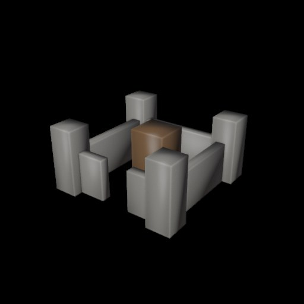
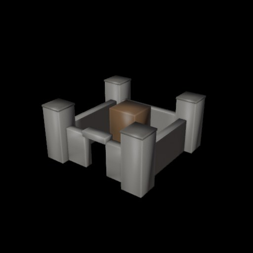
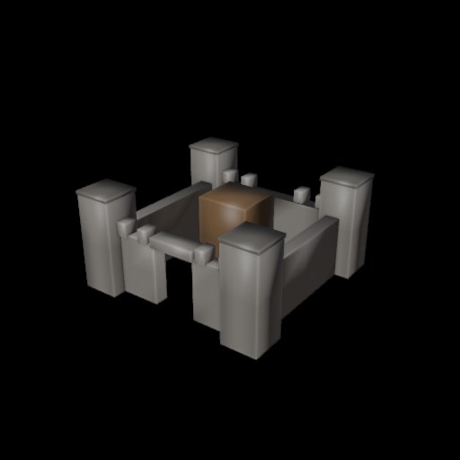

# Mudeligen2 – keskaegse kindluse astmeline 2 tunni katse

Algus 28.10.2026 kell 15:10 (Eesti aeg). Kohalik Qwen 3.5 LM Studio kaudu valib detailiplaanid ja hindab Blenderi loodud pilte. Mudeli põhipaigutus on lukustatud: neli nurgatorni, müüriring, väravaava ja sisehoovi peahoone.

**Need on tegelikud Blenderi JPG-renderdused, mitte illustratsioonid.** Iga uus aste salvestub kasutaja Windowsi arvutisse kahe PNG-vaate, GLB, BLEND ja ajalogiga.

| Aste | Tahke | Kulunud | Qweni hinnang | Pilt |
|---|---:|---:|---:|---|
| 1 | 50 | 28 s | 6/10 | [JPG](aste_00.jpg) |
| 2 | 100 | 51 s | 6/10 | [JPG](aste_01.jpg) |
| 3 | 200 | 76 s | 6/10 | [JPG](aste_02.jpg) |

## Aste 1 – 50 quadi

## Aste 2 – 100 quadi

## Aste 3 – 200 quadi

*See on esimeste kolme astme fikseeritud ülevaade. Järgmised astmed salvestatakse arvutis automaatselt; GitHubi pildid ei uuene ilma eraldi üleslaadimiseta.*
