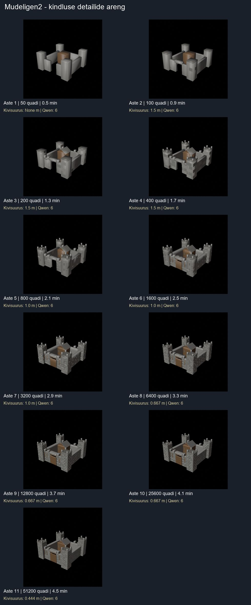
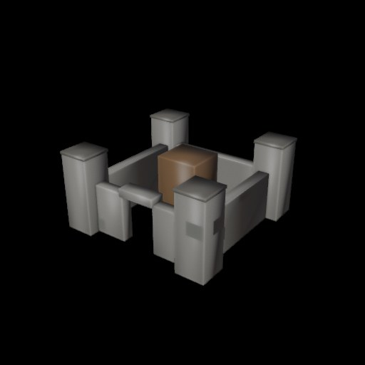
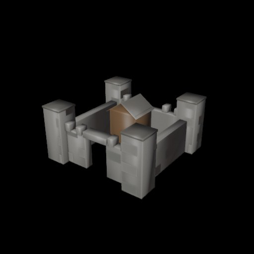
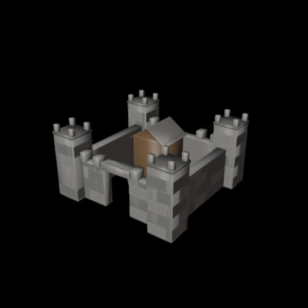
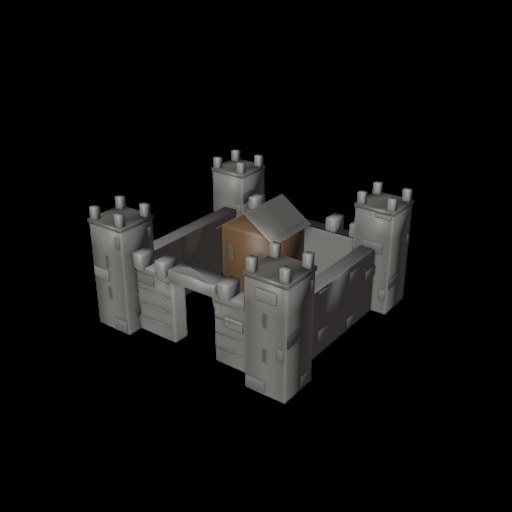
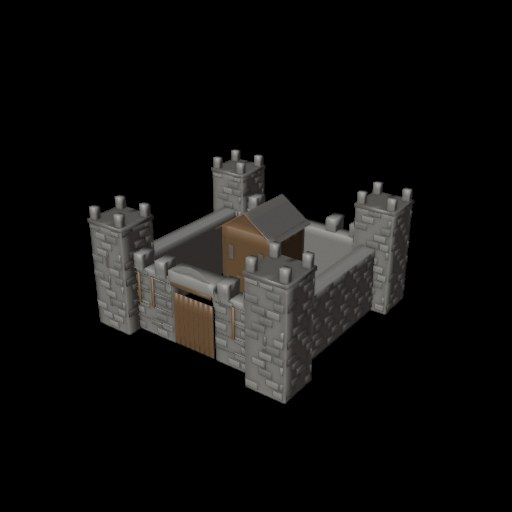
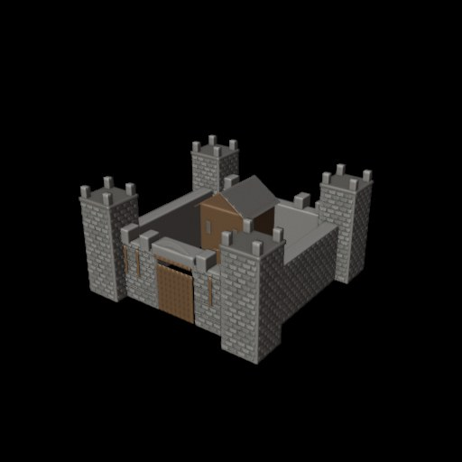

# Mudeligen2 – kindlus, iga kolme astme järel 1,5× väiksemad detailid

**Uus katse 28.10.2026 kell 16:37–16:42 Eesti aja järgi.**

Tegelikud Blenderi JPG-pildid, mitte illustratsioonid. Sinu kohalik LM Studio Qwen 3.5 9B juhtis detailiretsepti ja hindas kahte renderduspilti. Blender 5.2.3 ehitas kindluse fikseeritud põhipaigutusele, säilitades 4 torni, kaitsemüürid, väravaava ja sisehoovi peahoone.

Algne 50 quadi on lukustatud. Igale uuele astmele lisatakse 2× quade. Kiviplokkide mõõt kahaneb astmetel 2–4: 1.50 m, 5–7: 1.00 m, 8–10: 0.667 m, 11: 0.444 m. Lisatud on geomeetrilised kiviread, sakid, värava- ja aknadetailid ning viilkatus.

**Lõpptulemus:** 11 astet, 51 200 quadi, kulunud **271 sekundit (4 min 31 s)**. Kõik astmed said Qwenilt 6/10; 11. astme kordushindamine tehti pärast Windowsi väljundikodeeringu parandamist.

Kahetunnine aeg on maksimum; 11 määratud astet lõppesid varem. Rohkem quade ei võrdu tingimata suurema visuaalse kvaliteediga.

## Kõigi astmete koondpilt

| Aste | Quadi | Kivi suurus | Koguaeg | Qwen | Pilt |
|---:|---:|---:|---:|---:|---|
| 1 | 50 | põhikuju | 30.6 s | 6/10 | [JPG](aste_00.jpg) |
| 2 | 100 | 1.500 m | 54.0 s | 6/10 | [JPG](aste_01.jpg) |
| 3 | 200 | 1.500 m | 76.5 s | 6/10 | [JPG](aste_02.jpg) |
| 4 | 400 | 1.500 m | 99.8 s | 6/10 | [JPG](aste_03.jpg) |
| 5 | 800 | 1.000 m | 123.6 s | 6/10 | [JPG](aste_04.jpg) |
| 6 | 1600 | 1.000 m | 148.2 s | 6/10 | [JPG](aste_05.jpg) |
| 7 | 3200 | 1.000 m | 171.5 s | 6/10 | [JPG](aste_06.jpg) |
| 8 | 6400 | 0.667 m | 196.0 s | 6/10 | [JPG](aste_07.jpg) |
| 9 | 12800 | 0.667 m | 220.3 s | 6/10 | [JPG](aste_08.jpg) |
| 10 | 25600 | 0.667 m | 245.7 s | 6/10 | [JPG](aste_09.jpg) |
| 11 | 51200 | 0.444 m | 270.9 s | 6/10 | [JPG](aste_10.jpg) |

### Aste 1: 50 quadi – põhikuju – 30.6 sekundit

### Aste 2: 100 quadi – 1.500 m – 54.0 sekundit

### Aste 3: 200 quadi – 1.500 m – 76.5 sekundit

### Aste 4: 400 quadi – 1.500 m – 99.8 sekundit

### Aste 5: 800 quadi – 1.000 m – 123.6 sekundit

### Aste 6: 1600 quadi – 1.000 m – 148.2 sekundit

### Aste 7: 3200 quadi – 1.000 m – 171.5 sekundit

### Aste 8: 6400 quadi – 0.667 m – 196.0 sekundit

### Aste 9: 12800 quadi – 0.667 m – 220.3 sekundit

### Aste 10: 25600 quadi – 0.667 m – 245.7 sekundit

### Aste 11: 51200 quadi – 0.444 m – 270.9 sekundit

Kõik 11 astet on ka Windowsi arvutis GLB, BLEND, OBJ, PNG, PY ja JSON failidena kaustas `D:\Generaator3d\Mudeligen2_Nahtav\mudeligen\andmed\fortress_progressive\20261028_163751`.
