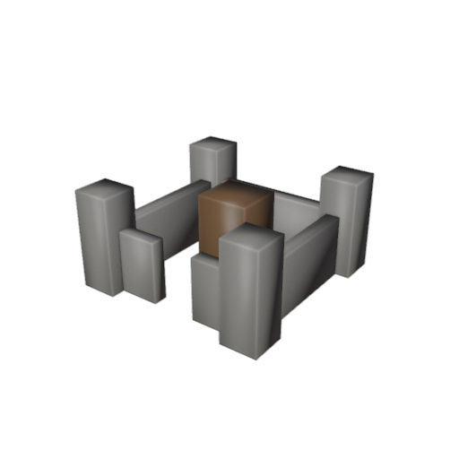
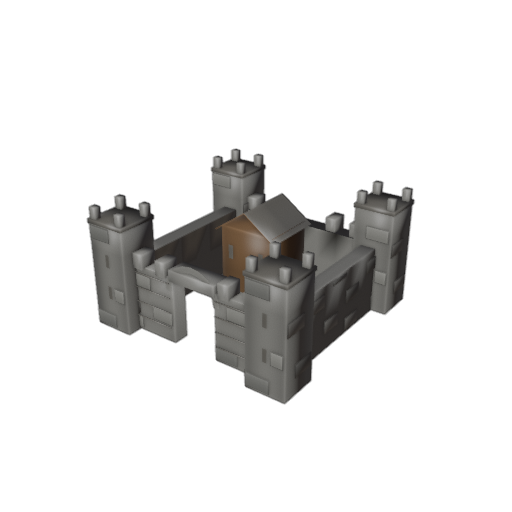
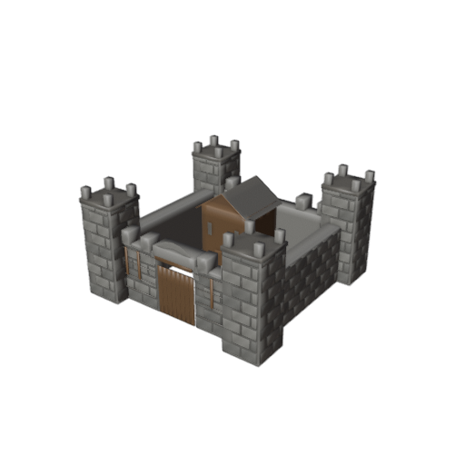
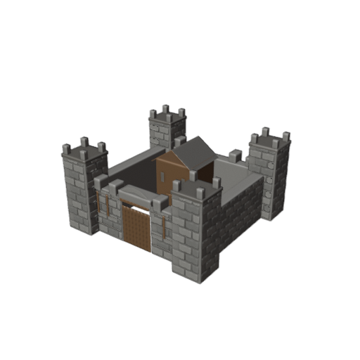

# Mudeligen2 – kindlus: iga kolme astme järel üha väiksem vähendus

**28.10.2026.** Kasutaja soovi järgi muudeti vähenemise samm ise väiksemaks, nii et viimase astme müürikivid ei muutuks liiga peeneks.

Varem: 1,50 → 1,00 → 0,67 → 0,44 meetrit.

Nüüd: **1,50 → 1,20 → 1,00 → 0,90 meetrit.**

| Astmed | Kiviploki sihtlaius | Vähenemine |
|---|---:|---:|
| 1 | algne 50-quadine kuju | — |
| 2–4 | 1,50 m | — |
| 5–7 | 1,20 m | −0,30 m |
| 8–10 | 1,00 m | −0,20 m |
| 11 | 0,90 m | −0,10 m |

## Kontrollitud Blenderi näidispildid

Need pildid genereeriti **päris Blender 5.2-ga** uuest protseduurse geomeetria skriptist. Näidatud on valitud astmed, mitte väide, et terve uus 11-astmeline Qweni treening õnnestus.

### 1. aste – 50 quadi

### 5. aste – 800 quadi, kivi 1,20 m

### 8. aste – 6400 quadi, kivi 1,00 m

### 11. aste – 51200 quadi, kivi 0,90 m

**Võrdlus vana versiooniga:** [vana 11. aste – 0,44 m kivi](../kindlus-detail-1_5-20261028/aste_10.jpg).

## Arvuti seis

Uuendatud `fortress_core_v3.py`, `fortress_progressive.py` ja käivitusfail on kohaliku Windowsi arvuti Mudeligen2 kaustas. Blenderi tehniline test läbis 50-, 800-, 6400- ja 51200-quadised versioonid.

Uus 11-astmeline LM Studio + Blenderi automaatkatse katkestas Windowsi Blenderi graafika-/mäluressursi krahhide tõttu pärast viit õnnestunud astet. Seega **täielik uus AI-hindamistsükkel ei õnnestunud**, kuid uue kivisuuruse 51 200-quadine Blenderi geomeetria ning pilt on kinnitatud.

Kohalik testikaust: `D:\Generaator3d\Mudeligen2_Nahtav\mudeligen\andmed\fortress_v3_smoke`.
