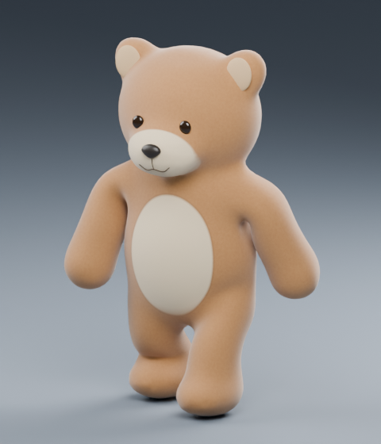

# ModelFactory Beta

Published by **Tõnu Marandi**. Experimental 3D modeling workflow for testing and feedback.

**Requires Blender 4.5.3, Python and an execution-capable Work/Codex environment.** The included runtime installer supports Linux x64. Installing the plugin alone does not install Blender on a phone and does not provide a hosted Blender service.

Model quality varies by subject: some models turn out better than others. Geometry, textures and animation may need manual correction. The workflow checks each new cloud point in at least three views spanning three independent directions before meshing. Hidden surfaces remain estimates. New subjects require suitable references and an object-specific recipe.

The beta plugin is free and does not sell products or process payments. ChatGPT and other third-party services may have their own plans, usage limits and charges.

The toy teddy is the branding example. Its historical reproduction recipe does not meet the newer three-direction requirement for new models. Existing model files are not improved simply by updating instructions.

[Support](MODELFACTORY_SUPPORT.md) · [Privacy](MODELFACTORY_PRIVACY.md) · [Beta terms](MODELFACTORY_TERMS.md)

GitHub beta distribution and public OpenAI directory approval are separate. This page does not claim that the plugin has been approved or published in the OpenAI directory.
