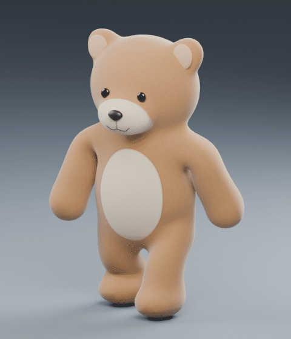

# Mudelitehas 0.1 — jalutav mängukaru

Jagatav **oskus + Blenderi töötluspakett**. Näidiseks on viimane Mudelitehasega loodud jalutav mängukaru, mitte koer. See on testversioon ühe kontrollitud karuretseptiga; avalikku pluginakataloogi lisamist ega kõigi olendite automaatset tuge see ei tähenda.



**[Laadi alla versioon 0.1](https://github.com/orogdor/blender-cloud-test/releases/tag/v0.1.0)** · **[Anna mudeli kohta tagasisidet](https://github.com/orogdor/blender-cloud-test/issues/new?template=mudelitehas-feedback.yml&version=0.1.0&recipe=teddy-walk)**

## Valmis mudelifailid

- [Animeeritud GLB](examples/teddy-walk/Jalutav_Mangukaru_10000.glb) — põhikeha 10 000 nelinurka, 23 luud, `Walk_Loop`, PBR ja lühikesed plüüsikiud; kokku 30 900 kolmnurka.
- [Kergem GLB](examples/teddy-walk/Jalutav_Mangukaru_LOD.glb) — 12 752 kolmnurka, sama luustikuanimatsioon, ilma eraldi plüüsikiududeta.
- [Redigeeritav Blenderi fail](examples/teddy-walk/Jalutav_Mangukaru_10000.blend).
- [Kontrolliaruanne](examples/teddy-walk/validation.json), [GLB taasavamise kontroll](examples/teddy-walk/export_reimport_validation.json) ja [algse näidise failiräsid](examples/teddy-walk/canonical-manifest.json).

Need näidisfailid on viimati üle antud karu täpsed koopiad. Uuesti käivitamine võib anda sõltuvustest ja platvormist tulenevalt teistsuguse failiräsi. Algse näidise terviklust saab kontrollida manifestiga.

## Töövoog

**Soovitud poosi 2D-pilt → sama tegelase ehituspoosi nelivaade → salvestatud punktipilv → mesh → luustik/kaalud → animatsioon → kontroll.**

Selle karu ehituspoos on T-poos. Animatsioon on umbes kahe sekundi pikkune kohapeal kõndimise kordus. Mängus tuleb edasiliikumine lisada eraldi. Blenderis on kaader 0 ehituspoos ja kaadrid 1–49 kõnd.

## Kasutamine

1. Laadi release'i oskuse ZIP alla ja paiguta selles olev `mudelitehas` kaust oma oskuste kataloogi. GitHubist kloonides asub oskus kaustas `plugins/mudelitehas/skills/mudelitehas`. Oskuseid toetavas keskkonnas kutsu seda `$mudelitehas` nimega. Veebiteenust ega universaalset ühe nupu paigaldust siin pole.
2. Paigalda Blender **4.5.3** ning Python 3.12 sõltuvused:

   ```bash
   python -m pip install -r plugins/mudelitehas/skills/mudelitehas/assets/requirements.txt
   ```

3. Linux x64 puhul saab fikseeritud Blenderi ja selle Pythonile sobiva Pillow ette valmistada:

   ```bash
   python plugins/mudelitehas/skills/mudelitehas/scripts/install_runtime.py --directory /tmp/mudelitehas-runtime
   ```

   Paigaldaja väljastab `BLENDER` ja `MUDELITEHAS_PYTHONPATH` teed. Määra teine keskkonnamuutujaks ning anna Blenderi tee käivitajale.

4. Käivita eraldi tühja töökataloogi:

   ```bash
   python plugins/mudelitehas/skills/mudelitehas/scripts/run.py \
     --workdir runs/teddy-walk --blender /path/to/blender --preview quick
   ```

Sama käsk jätkab olemasolevat tööd. `--preview none` jätab renderduse vahele, `--preview full` teeb suurema eelvaate, `--mode verify` kontrollib olemasolevaid faile ja `--mode rebuild` ehitab selle märgistatud töökataloogi mudeli uuesti. Võõra sisuga kataloogi ei kirjutata üle.

Tavaline käsk on `Mudelitehas 10000 3 jalutav mängukaru animatsiooniga`. Teise olendi või ruutude arvu puhul peatub 0.1 käivitaja selge teatega: sellele tuleb koostada ja testida eraldi retsept. Lähtepildid on paketis juba olemas; GitHubi töövoog ise pildigeneraatorit ei käivita.

## Tagasiside ja parandused

Vali GitHubis **Issues → Mudelitehas: mudeli tagasiside**. Lisa versioon, probleemi kirjeldus, vajadusel kaader ja pilt. Käivitatud töö jaoks saab teha väikese tagasisidepaketi:

```bash
python plugins/mudelitehas/skills/mudelitehas/scripts/feedback.py \
  --workdir runs/teddy-walk --category animation \
  --description "Kirjelda siin märgatud viga" --frame 13
```

See loob ZIP-i versiooni, töö ID, failiräside ja valitud kontrollidega ning väljastab eeltäidetud veateate lingi. Midagi ei saadeta automaatselt; mudelid, pildid, toorlogid ja keskkonnamuutujad ei lähe vaikimisi paketti.

Parandusprotsess: taasesita salvestatud sisenditega → paranda vastavat etappi → korda vea katset ja karu põhikontrolli → anna välja uus versioon. Varasema release'i mudel jääb võrdluseks alles.

## Kontrollid ja piirangud

Käivitaja kontrollib Blenderi versiooni, lähtepiltide räsisid, etappide väljumiskoode ning puuduvaid väljundeid. Vahemälu eristab rekonstruktsiooni, võrku, poosi, viimistlust ja eelvaadet. GLB kontroll avab ekspordi uuesti ning võrdleb kõnni poose ja korduse sulgumist.

Tulemus on stiliseeritud, sügavus ja varjatud liigesed hinnangulised. Karv on PBR-pinnadetaili ja lühikeste kolmnurksete kiudude kombinatsioon. Mitme vaate ülevaatus ei tõesta ammendavalt kõigi eneselõikumiste puudumist. Automaatne paigaldaja ja CI on Linux x64 jaoks; teisi platvorme pole selle versiooni väljalaskekatses kinnitatud.
